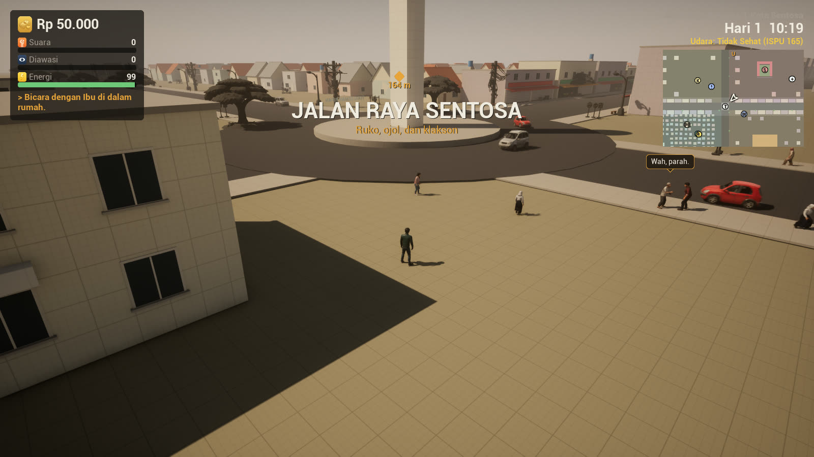
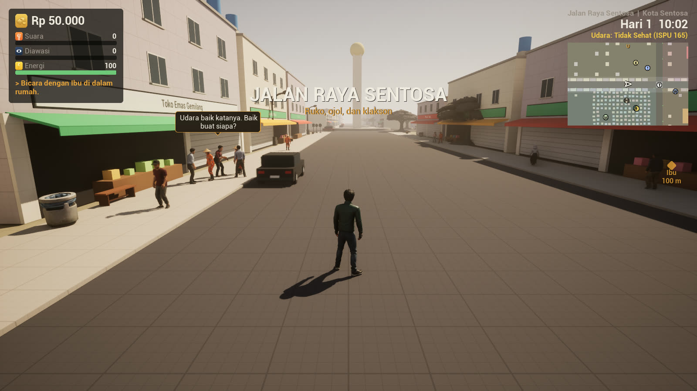
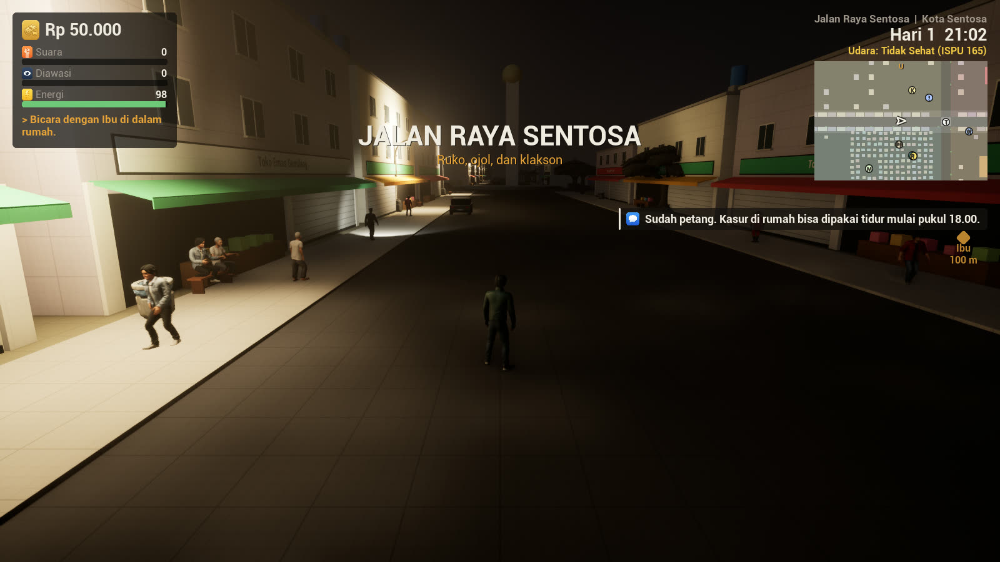
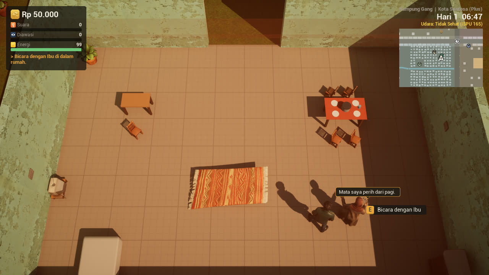
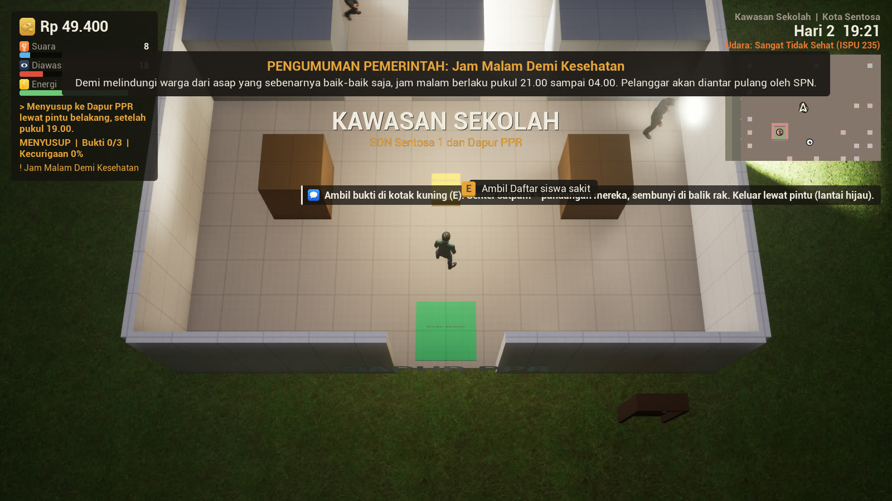
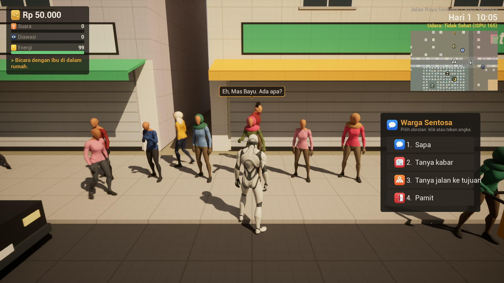
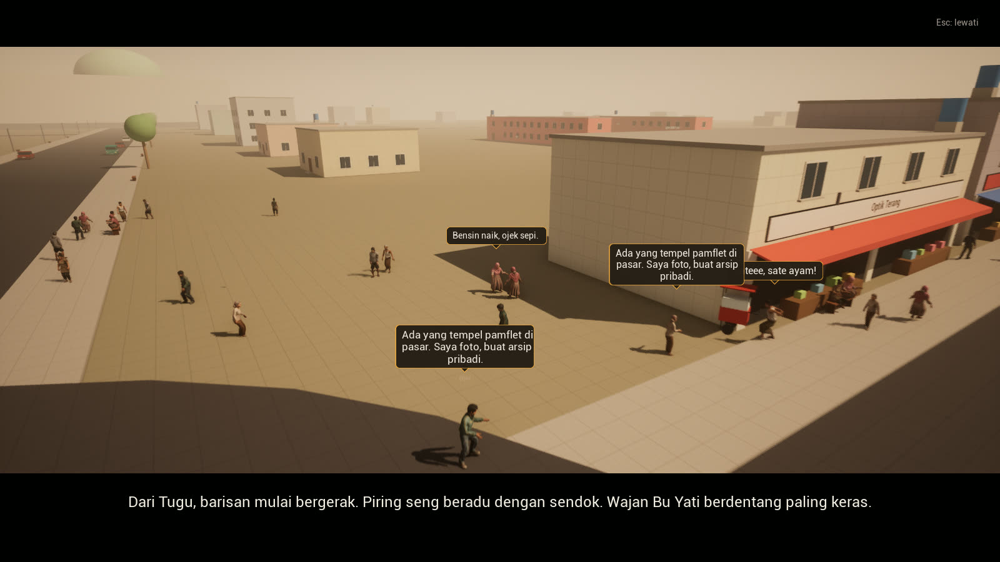

# Gemah Ripah

**An open-world political satire game built in Unreal Engine 5.8 with C++.**
Solo project by **Eka Putra Meravigliosi** ([@EkaPutra0856](https://github.com/EkaPutra0856)): design, level design, programming and content.

You play as **Bayu**, a motorbike ride-hailing (ojol) driver in **Kota Sentosa**, a city in the fictional Republic of Gemah Ripah. Smog thickens every day while the government insists the air is "good". Across five chapters, Bayu goes from delivering food orders to exposing a poisoned school-meal program, organizing a protest, running an underground radio station, defending a market from eviction, and guarding a polling station on election day.

> **Videos, trailer and full screenshot set:** [Google Drive folder](https://drive.google.com/drive/folders/1uAwsc2iHq1XnjlNHGbm3V8tqUHKBEhjc)

---

## Highlights

- **Hand-planned open city** (World Partition, ~1 km): five districts, a road network built around a central roundabout monument, sidewalks, alleys and zebra crossings.
- **Living world:** ~36 simulated citizens by day, left-lane traffic with roundabout yielding rules, and police patrols that react to the player's "Watched" (Diawasi) level.
- **Interiors with an automatic top-down camera**, used for conversations, furniture-filled rooms and stealth infiltration.
- **Data-driven story system:** all five chapters, quests, dialogue, cutscenes and minigames are authored in JSON and hot-reloadable without recompiling.
- **Gameplay logic written in C++** (~36k lines). UI is built in C++ (UMG/Slate) without Widget Blueprints.

---

## Level Design

### City layout: Kota Sentosa
The city is designed as one readable map split into five districts, each with its own purpose in the story and its own street character:

| District | Role in play |
|---|---|
| **Kampung Gang** | Bayu's home neighbourhood: tight alleys, tiled-roof houses, the night-watch post (Pos Ronda) |
| **Pasar** | Traditional market, street vendors, the site of the Chapter 4 eviction |
| **Kawasan Sekolah** | Elementary school and the community health centre (Puskesmas) |
| **Pusat Pemerintahan** | Village office (Kelurahan), police post, the monumental Council Building (Gedung Dewan) |
| **Jalan Raya** | Main road with shophouses (ruko), internet café, traffic and ride-hailing hotspots |

Design decisions:
- **Roundabout landmark (Tugu).** A tall monument at the centre of the main road acts as the player's orientation anchor, a traffic hub and the starting point of the Chapter 2 protest march.
- **Road hierarchy.** A main road with marked lanes and zebra crossings feeds into narrower district streets and pedestrian-only alleys, so motorbike routes and on-foot routes feel different.
- **Sidewalks as gameplay space.** Benches, vendor carts and crossing points give citizens places to walk, sit, chat and cross, and give the player places to be seen.
- **Procedural facades.** At runtime, `GRFacades` dresses grey-box building volumes with doors, windows, rolling doors, open storefronts, coloured awnings, fictional shop signs, tiled roofs and rooftop water tanks (all instanced, no collision), so the layout can be iterated before final art replaces the blocks.
- **Terrain.** Hills, a river and canals with bridges, gently rolling city ground and drainage ditches.
- **City map and minimap** generated from the actual building footprints (`GRMapSubsystem`), with district names and quest markers.

### Living world
- **Citizens (`GRCrowd`)**: walk sidewalks and alleys, cross only at zebra crossings when no car is near, chat in groups of two or three, sit on benches, jog in the morning and evening, and push food carts at night. Population scales with time of day (36 by day, 16 at dusk, 6 late at night). Spawned out of camera view and recycled when far away.
- **Traffic driving logic (`GRTraffic`)**: cars and minibuses (angkot) keep to the left lane, circle the Tugu clockwise while yielding to vehicles already in the roundabout, U-turn at the city edge, keep following distance, stop for pedestrians, honk, and slowly overtake parked bikes. Collisions are physics-based: hit cars get pushed, can bump other cars, and the driver gets out to argue before returning to the lane.
- **Reactions to the player**: citizens greet, wave or glance suspiciously depending on the player's Watched level; at high levels they tail Bayu and may report him. Reckless riding causes ragdoll falls, angry crowds and, if repeated, a small riot.
- **Police patrols (SPN)**: solo and paired officers patrol, stand guard and radio in; at high Watched levels they chase, cut off escape routes and arrest.
- **Day/night cycle**: one day equals 24 real minutes, with sun, moon, smog fog, street lights and a daily rising air-pollution index (ISPU).

| Day | Night |
|---|---|
|  |  |

### Interiors with top-down camera
Entering a room volume (`GRTopDownRoomVolume`) smoothly switches the camera from third-person to top-down. Interiors (Bayu's house, the village office, the internet café, the night-watch post, the health centre, the police post, a photocopy shop) are furnished from data (`furniture.json`), with NPCs seated at desks and talking with gestures.

### Stealth levels
Infiltration missions take place **inside the real rooms of the city**, not in a separate screen. A JSON grid turns into shelves, partitions, evidence boxes and guards with flashlight vision cones. Staying in a light cone too long gets the player caught (retry or escape). Used in four chapters: the PPR kitchen, the village archive, a marketing office, and an election logistics warehouse.

### Player-citizen chat
Press **E** next to any citizen to open a chat menu while the world keeps running: greet (they wave back), ask how things are (chapter-specific lines), ask for directions to the current objective (compass direction and distance), or buy street food from vendors. Speech bubbles appear above heads, with shaking, framed bubbles for shouts.

---

## Gameplay Systems

- **Third-person character** with smooth camera, sprint and zoom; full keyboard/mouse and gamepad support (Enhanced Input built in C++).
- **Motorbike**: throttle, brake/reverse, speed-dependent turning radius, lean into corners, parking where you dismount.
- **OjekKu ride-hailing**: accept or decline orders on the in-game phone, pick up and drop off passengers, answer their small talk.
- **Status meters**: money, Voice (Suara), Watched (Diawasi) and Energy. Government "announcements" add new rules that turn ordinary actions into violations.
- **Phone, journal and chapter map**: phone app grid, quests, items and family tab.
- **Minigames**: stealth infiltration, internet-café upload, stencil newspaper printing, pirate radio broadcast with a listener meter.
- **Branching outcomes**: dialogue with tension meters; choices carry across chapters and decide the final election result.
- **Save system**: autosave plus three manual slots, persistent across chapters and maps.
- **Automated testing and screenshots**: run the game with `-GRScript=<file>` to replay timed console commands and capture screenshots.

## The Five Chapters

1. **Asap dan Piring** ("Smoke and Plates"): Bayu's sister is poisoned by the free school-meal program. Investigate, infiltrate the program kitchen at night, upload the evidence.
2. **Turun ke Jalan** ("Take to the Streets"): gatherings are banned. Rally neighbours, design and post flyers while avoiding patrols, lead an empty-plate march from the Tugu to the Council Building and negotiate with the commander.
3. **Pasal Karet** ("The Rubber Law"): a friend is jailed for insulting an official. Break into the village archive, print an underground newspaper and run a pirate radio station.
4. **Proyek Mercusuar** ("The Lighthouse Project"): an 88-storey tower is planned on top of the market. Trace the developer, steal the real plans and defend the market gate against an excavator.
5. **Suara Rakyat** ("Voice of the People"): a mayoral election full of vote-buying and pre-marked ballots. Expose the fraud and guard polling station TPS 07. The count reflects choices from every chapter.

---

## Technical Overview

| Folder (`Source/GemahRipah`) | Contents |
|---|---|
| `Core/` | Game mode, player controller (input, camera modes, pause), game instance, settings, cheat/debug commands |
| `Player/` | Third-person character, interaction component |
| `World/` | Citizens, traffic, NPCs and police, facades, stealth level, map subsystem, districts, day/night |
| `Story/` | Data-driven story runtime: conditions, actions, quests, spawns, events, cutscenes |
| `Camera/` | Top-down room volume |
| `Systems/` | Persistent subsystems: status, rules, progress, save, game flow, notifications |
| `UI/` | C++-built UMG screens, HUD, phone, dialogue, chapter map, speech bubbles, chat menu |

Engineering choices:
- Logic in C++ for reviewable diffs; Blueprints only for content tweaks.
- Story content in JSON (`Content/Data/`) with a small condition/action language, reloadable at runtime (`GRReloadData`).
- Python editor scripts (`Tools/Python`) generate maps, materials, furniture and animation variants.

## Building

Requirements: Unreal Engine 5.8, Visual Studio 2022 (MSVC 14.44).

1. Clone the repository (Git LFS required for the icon PNGs in `Content/Data/Icons`).
2. Right-click `GemahRipah.uproject` and generate project files, or run `Tools\Build.bat` with the editor closed.
3. Open `GemahRipah.uproject`.

> Some environment dressing uses third-party marketplace packs that are **not** redistributed in this repository. The game logic, data and grey-box city still open without them.

## Credits

Third-party assets (CC0 audio and VFX from Kenney and OpenGameArt, UE template content) are listed in [`Docs/CREDITS.md`](Docs/CREDITS.md). UI icons and character portraits were generated by the author with Google Gemini.

## License

Source code: all rights reserved (portfolio viewing only) unless stated otherwise. Third-party assets remain under their own licenses.
